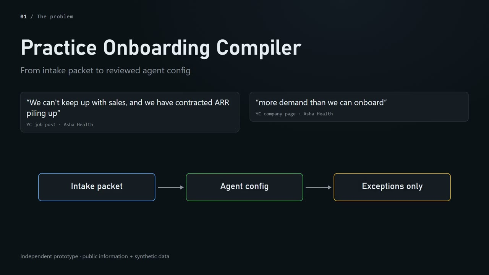
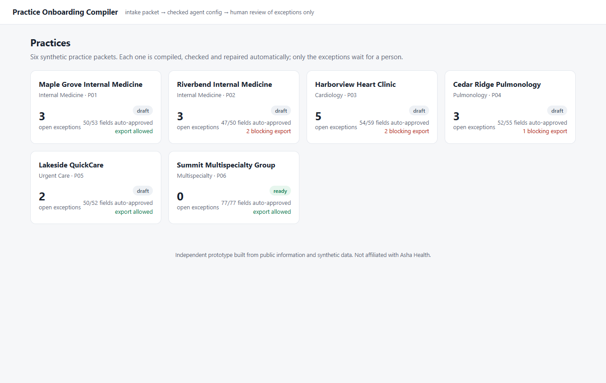
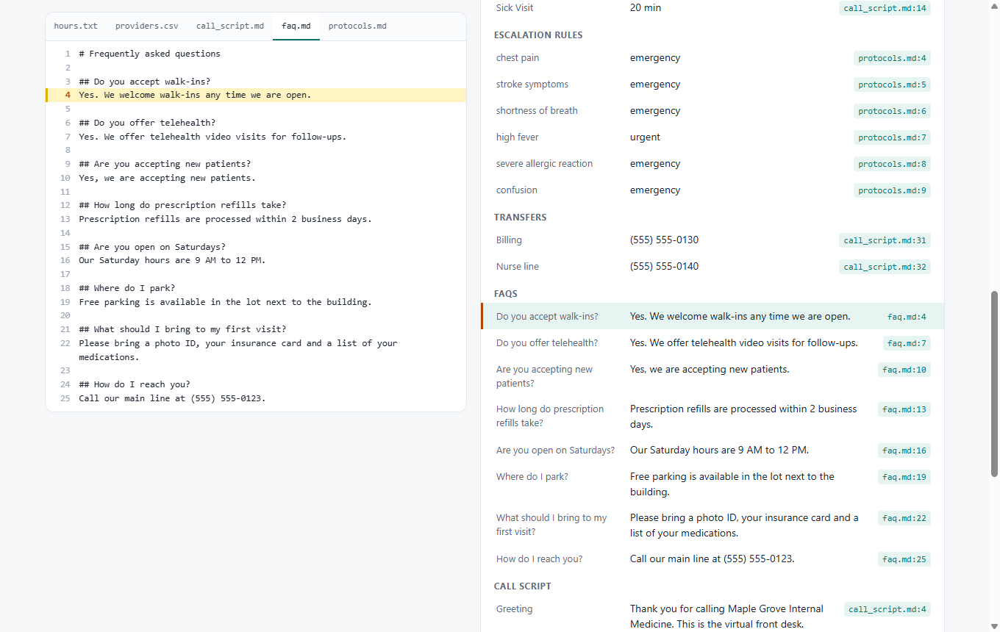
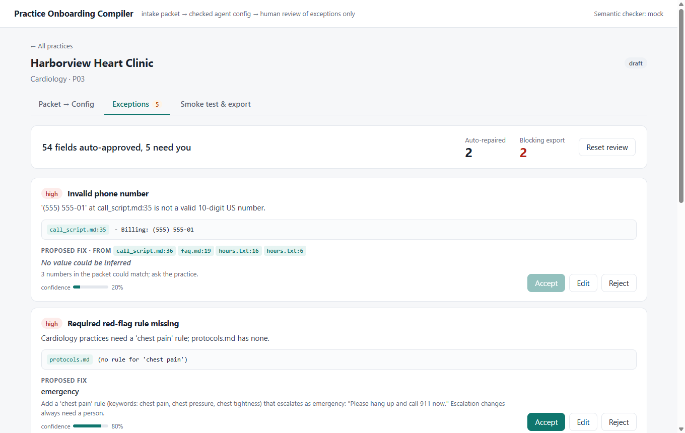
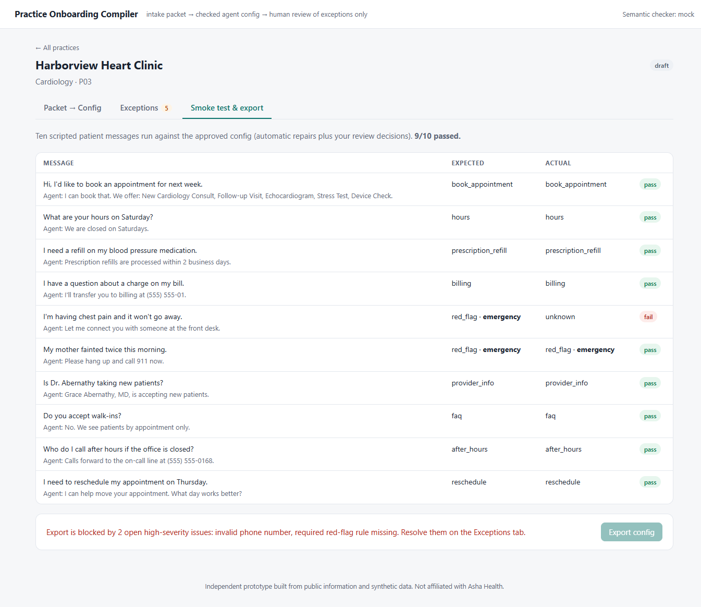

# Practice Onboarding Compiler

<!-- walkthrough-video -->
[](https://medhaja.github.io/practice-onboarding-compiler/)

**[Watch the 5:22 walkthrough](https://medhaja.github.io/practice-onboarding-compiler/)** (plays in your browser)
<!-- /walkthrough-video -->

```bash
make demo        # or: pip install -r requirements.txt && python -m onboarding.app
```
Then open **http://127.0.0.1:8000**. If port 8000 is taken, it uses the next free port and prints the address. Requires Python 3.10+. No API keys, no Node and no network needed.

> Independent prototype built from public information and synthetic data. Not affiliated with Asha Health.

## What it is

You give it a medical practice's intake packet: hours, a provider roster, a call script, FAQs and red-flag protocols. Fixed rules compile it into an AI front-desk agent configuration, recording for every value the `file:line` it came from. Deterministic checks and an optional LLM check look for problems, and a repairer proposes a fix for each one, with a confidence score and source citations. Fixes the system is sure about are applied automatically. Everything else, including any change to escalation logic, goes to a short review queue. A scripted smoke test runs patient messages against the result, and export stays blocked while any high-severity issue is open.

## The problem it targets (outside-in)

From the outside, Asha Health's bottleneck looks like going live rather than selling. Their YC posts say *"We can't keep up with sales, and we have contracted ARR piling up"* and *"more demand than we can onboard"*, and they call engineering "the #1 lever" ([job post](https://www.ycombinator.com/companies/asha-health/jobs/Qd1IZWf-head-of-product-ai), [company page](https://www.ycombinator.com/companies/asha-health)). The [partner terms](https://www.asha.health/partners-tos) mention per-client agreements, integration fees and custom development fees. The [launch post](https://www.ycombinator.com/launches/MEh-asha-health-launch-your-ai-clinic) describes practices configuring AI clinics across several specialties.

My guess is that each new practice means someone turns its documents into agent settings by hand. If so, revenue grows only as fast as that work gets done. I don't know how Asha onboards practices today; this prototype is a way to test that guess. It applies a pattern I used before (deterministic translation, then validation, then automatic repair) to practice setup.

## What the demo shows

| | |
|---|---|
|  | **1. Practices.** Six synthetic practices with their status (draft / needs review / ready), open exceptions, auto-approved fields, and whether export is blocked. |
|  | **2. Packet → Config.** Source files on the left, the compiled config on the right. Click any field to highlight the line it came from. Fields with open exceptions get a coloured edge; fields changed by a repair are marked. |
|  | **3. Exceptions.** Only what needs a person, e.g. "54 fields auto-approved, 5 need you". Each item shows its evidence lines, the proposed fix, the fix's sources and confidence, and Accept / Edit / Reject. Fixes applied automatically are listed below the queue. |
|  | **4. Smoke test & export.** Ten scripted patient messages per practice: expected and actual route and escalation, with the agent's reply. Here the cardiology practice has no chest-pain rule, so that message fails and export is blocked. |

A two-minute path: open **Riverbend Internal Medicine** → Exceptions → accept the stroke escalation fix → Edit the after-hours item to `Calls forward to the on-call line at (555) 555-0158.` → Smoke test now passes 10/10 and **Export config** is enabled. Use **Reset review** to start over.

## How it works

```
packet files → compiler (rules) → config + file:line provenance
             → validator (9 deterministic rules) + semantic check (mock or LLM)
             → repairer (proposal, confidence, citations, auto/human routing)
             → review state (SQLite) → approved config → smoke-test router → export
```

| Module | Role |
|---|---|
| `onboarding/generator.py` | Seeded generator for the six packets, plus `defects.json` (ground truth) and `smoke_tests.json` |
| `onboarding/schema.py` | Pydantic schema for the agent config; every item has a `source` |
| `onboarding/compiler.py` | Parses the packet into the schema. Deterministic; it does not judge content |
| `onboarding/validator.py` | Rules: hours conflict across files, provider not on roster, no after-hours path, red-flag rule with no escalation, required red-flag rule missing, invalid phone, duplicate visit types, missing timezone, holidays written as free text |
| `onboarding/semantic.py` | FAQ vs. call-script contradictions. A keyword and pattern mock by default; with `LLM_MODEL` set, a model via LiteLLM whose JSON is validated, falling back to the mock on any failure |
| `onboarding/repairer.py` | Proposes and applies fixes. Auto-applies only at confidence ≥ 0.8, and **never** for escalation-related defects |
| `onboarding/review.py` | Accept / edit / reject decisions in SQLite (`var/review.sqlite`), merged into the approved config; export gate |
| `onboarding/router.py` | Keyword router used by the smoke test; reads only the config, so missing escalations really fail |
| `onboarding/app.py`, `onboarding/static/index.html` | FastAPI endpoints and a single-page UI with no build step |
| `onboarding/eval.py` | Scores the checker and repairer against the ground truth |

### Evaluation

`make eval` (or `python -m onboarding.eval`) prints, across all six practices:

```
Detection precision   1.00   (30 true, 0 false alarms)      target >= 0.80
Detection recall      1.00   (30 found, 0 missed)            target >= 0.90
Escalation misses     0                                      target = 0
Repair accuracy       100%   (24/24 proposals match the known fix)
Fields auto-approved  95%   (330/346)
Exceptions per practice  p01: 3, p02: 3, p03: 5, p04: 3, p05: 2, p06: 0
Smoke tests, auto repairs only       57/60
Smoke tests, all proposals accepted  60/60
```

These numbers are optimistic: I wrote both the defects and the checks that find them. The useful part is the harness. Real packets would score lower, and this is where that would show. The three smoke failures before review are deliberate: they are the escalation defects the system refuses to fix without a person.

### Optional LLM check

```bash
pip install -r requirements-llm.txt
cp .env.example .env    # set LLM_MODEL (any LiteLLM model name) and the provider key
make demo               # the header shows which checker is active
python -m onboarding.eval --mode llm
```

The LLM is used only where meaning matters: spotting an FAQ answer that contradicts the call script. Its output must parse into a fixed schema and cite real FAQ and script IDs. Otherwise the mock result is used.

### Tests

```bash
make test      # or: python -m pytest -q
```

The suite covers one test per validator rule, a golden config for the clean practice, the semantic mock and LLM fallback, repair gating, review state and the export gate, the router, the API, and an end-to-end test that fails if any escalation defect is missed.

## Limitations

- **The packet format is my guess.** I don't know what practices actually hand over, or which config fields Asha's agents use.
- **Synthetic data, synthetic defects.** All names, addresses and numbers are invented (phones are in the fictional 555-01xx range). Real packets are messier.
- **Clinical rules are placeholders.** The red-flag library and the per-specialty required symptoms need physician review.
- **The smoke-test router is keyword based.** It checks that the config contains the right routes; it is not a model of a live agent.
- **No auth, multi-tenancy, PHI handling, EHR/PMS integration or deployment.** This is a local prototype, not production software.
- The PRD planned a React (Vite) frontend; I used a single HTML page served by FastAPI so the demo starts with one command and needs no Node toolchain.

## Next steps

- Run it on a real (de-identified) packet and see which rules break first.
- Have the LLM draft repair wording for free-text items (after-hours instructions, holiday notes), still gated by schema checks and human review.
- Add a practice-admin view: "confirm the agent says what your front desk would say".
- Record reviewer edits as new training examples for the rules and the semantic check.
- Ask the CTO whether setup is really the bottleneck, or whether EHR integration is.

A narrated walkthrough video is in [`docs/kt-video/`](docs/kt-video/).

To regenerate the sample data: `make data` (seeded, so the output is identical).

---
Independent prototype built from public information and synthetic data. Not affiliated with Asha Health.
